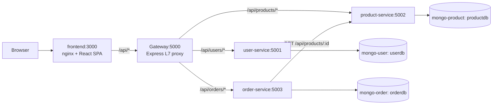
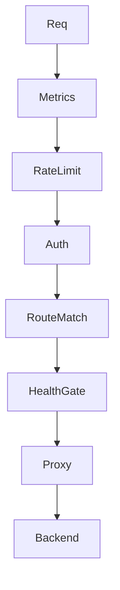

# E-Commerce Microservices with Custom L7 API Gateway

Microservices-based e-commerce application with a custom Layer-7 API Gateway (Node.js/Express) and React frontend.
Runs locally via Docker Compose (dev) and in production on AWS EC2 (`docker-compose.prod.yml`) with Secrets Manager + CloudWatch.

## Architecture

```
Browser → localhost:3000 (nginx) ─┬─ /api/* → localhost:5000 (Gateway) ─┬─ /api/users/*  → user-service:5001
                                  │                                    ├─ /api/products/* → product-service:5002
                                  │                                    └─ /api/orders/*  → order-service:5003
                                  └─ /*  → React SPA (static files)          └─ MongoDB (3 containers)
```

## Components

| Component | Tech | Port | Health |
| --------- | ---- | ---- | ------ |
| React Web App | React 18 + Vite 5 + nginx 1.27 | 3000 | `GET /` |
| Custom API Gateway | Node.js + Express | 5000 | `GET /health` |
| User Service | Node.js + Express + Mongoose | 5001 | `GET /health` |
| Product Service | Node.js + Express + Mongoose | 5002 | `GET /health` |
| Order Service | Node.js + Express + Mongoose | 5003 | `GET /health` |
| MongoDB (User/Product/Order) | mongo:7 | internal | `mongosh ping` |

## Quick start (development)

```bash
cp .env.example .env   # fill in values; .env is gitignored
docker compose up --build -d
```

Open http://localhost:3000 in your browser.

## Production (local preview of the AWS shape)

```bash
docker compose -f docker-compose.prod.yml up --build -d
```

Differences from dev: baked images run `npm start` (no bind-mounts), isolated
`*-prod` volumes/network, internal-only backends, MongoDB auth, `NODE_ENV=production`
(fail-closed secrets + admin), required secrets fail fast (`${VAR:?}`), light CPU/RAM limits.
Same file is what runs on EC2 (see [AWS deployment](#aws-deployment)).

## Gateway features

- **L7 reverse proxy** — http-proxy-middleware routes `/api/users/*`, `/api/products/*`, `/api/orders/*` to their respective microservices; boundary-aware matching (`/api/products` never matches `/api/products-invalid`, longest prefix wins); atomic proxy-table rebuilds
- **JWT verification** — validates Bearer tokens on `auth:true` routes; injects `X-User-Id` header to downstream services; secret resolved `AWS_JWT_SECRET_ID` (Secrets Manager, IAM role) → `JWT_SECRET` env → fail-fast in production; warmed at boot so bad wiring crashes loudly on deploy, not on first login
- **Sliding-window rate limiting** — 2000 requests per 60s per IP (configurable via `routes.json`); returns `Retry-After` and `X-RateLimit-*` headers on 429
- **Health monitoring** — polls each backend every 10s; fail-closed: only `HEALTHY` backends receive traffic (`UNKNOWN`/`UNHEALTHY` → 503; 502 reserved for mid-request proxy errors)
- **Dynamic config reload** — `POST /gateway/reload` (admin token) re-reads `routes.json`; invalid configs rejected with previous table kept
- **Admin protection** — `/gateway/status`, `/gateway/metrics`, `POST /gateway/reload` require `X-Admin-Token` (warn-allow in dev, 403 fail-closed in production)
- **Restricted CORS** — allow-list via `CORS_ORIGIN` (no open `cors()`)
- **Metrics** — counters by route and status, average latency, uptime; `GET /gateway/metrics`

## Gateway endpoints (bypass rate limiting; admin ones need `X-Admin-Token`)

| Endpoint | Method | Description |
| -------- | ------ | ----------- |
| `/health` | GET | Gateway liveness check (open) |
| `/gateway/status` | GET | Routes, backends, rate-limit config, last error (admin) |
| `/gateway/reload` | POST | Re-read and apply `routes.json` (admin) |
| `/gateway/metrics` | GET | Request counters, latency, uptime (admin) |

## API endpoints (through gateway at `localhost:5000`)

### User Service
- `POST /api/users/register` — body `{ username, email, password }` → 201 + token
- `POST /api/users/login` — body `{ username, password }` → 200 + token
- `GET  /api/users/profile` — header `Authorization: Bearer <token>` → 200

### Product Service
- `GET /api/products` — optional `?category=`
- `GET /api/products/search?q=...`
- `GET /api/products/:id`

### Order Service
- `POST /api/orders` — body `{ items: [{ productId, quantity }] }` (authenticated; name/price re-fetched from the product service, client values ignored)
- `GET  /api/orders` — authenticated, own orders only
- `GET  /api/orders/:id` — authenticated, own order only

## Configuration

| Env var | Default | Purpose |
| ------- | ------- | ------- |
| `JWT_SECRET` | none (fail-fast in prod) | Shared secret for signing/verifying JWTs (user/order services; gateway fallback) |
| `AWS_JWT_SECRET_ID` | unset (local dev) | Secrets Manager secret ID/ARN for the JWT secret; preferred by the gateway when set |
| `AWS_REGION` | `us-east-1` | Region for the Secrets Manager client |
| `GATEWAY_ADMIN_TOKEN` | none (403 in prod) | Token for `/gateway/*` admin endpoints (`X-Admin-Token` header) |
| `CORS_ORIGIN` | `http://localhost:3000` | Comma-separated allowed browser origins |
| `NODE_ENV` | `development` | `production` enables fail-closed secrets/admin |
| `JWT_EXPIRES_IN` | `2h` | JWT lifetime |
| `MONGO_ROOT_USERNAME` / `MONGO_ROOT_PASSWORD` | prod only (required) | MongoDB root credentials (services URL-encode them, so any characters work) |
| `MONGO_URI` | per-service default | Host template; credentials come from `MONGO_USER`/`MONGO_PASSWORD` when set |
| `PRODUCT_SERVICE_URL` | `http://product-service:5002` | Order service → product service for server-side pricing |

See `.env.example` for the full template. `.env` is gitignored — never commit it.

## Secrets management

Single JSON secret (e.g. `prod/ecommerce/app`):

```json
{"JWT_SECRET": "<32+ chars>", "GATEWAY_ADMIN_TOKEN": "<random>", "MONGO_ROOT_PASSWORD": "<any chars>"}
```

Resolution in the gateway (`secretManager.js`): `AWS_JWT_SECRET_ID` via SDK default chain
(EC2 instance role — no keys in code/config) → `JWT_SECRET` env → throw in production.
Fetched once at boot (loud crash on misconfiguration) and cached; mock-tested without AWS
(`secretManager.mocktest.js`, `docker exec gateway node src/services/secretManager.mocktest.js`).
Backend services take the same `JWT_SECRET` from env; non-secret settings (`CORS_ORIGIN`,
`NODE_ENV`, `JWT_EXPIRES_IN`, `MONGO_ROOT_USERNAME`) stay plain config.

## Project structure

```
├── docker-compose.yml          (dev: nodemon, bind-mounts, no-auth Mongo)
├── docker-compose.prod.yml     (prod: npm start, isolated volumes, Mongo auth, fail-fast secrets)
├── .env.example
├── services/
│   ├── user-service/           (bcrypt, JWT issue, verifies gateway-forwarded tokens)
│   ├── product-service/        (auto-seeds 12 products)
│   └── order-service/          (server-side pricing via productClient.js; mongoUri.js credential encoding)
├── gateway/
│   └── src/
│       ├── config/             (routes.json, schema.js, configLoader.js)
│       ├── services/           (proxy.js, healthChecker.js, secretManager.js + .mocktest.js)
│       ├── middleware/         (auth.js, adminAuth.js, rateLimiter.js, metrics.js)
│       └── utils/              (logger.js, routeMatcher.js)
├── frontend/
│   ├── src/
│   │   ├── api/client.js       (fetch wrapper)
│   │   ├── auth/AuthContext.jsx
│   │   ├── pages/              (Login, Register, ProductList, ProductDetail, PlaceOrder, OrderHistory)
│   │   └── components/         (Navbar, ProtectedRoute)
│   └── nginx.conf
└── docs/
    ├── postman_collection.json (14 requests incl. tamper-proof test; adminToken variable)
    ├── load-test.js            (k6: pass ADMIN_TOKEN env for /gateway/status)
    └── evidence/               (EVIDENCE.md + captured outputs, tokens redacted)
```

## AWS deployment

Live topology (single EC2, `us-east-1`):

```
Internet → EC2 t3.small ─┬─ :3000 frontend (nginx + SPA)
                         ├─ :5000 gateway (Node, npm start)
                         ├─ internal: user/product/order services (expose only)
                         ├─ internal: 3× MongoDB with auth
                         ├─ Secrets Manager prod/ecommerce/app ← JWT at gateway boot (IAM role, GetSecretValue on one ARN)
                         └─ CloudWatch /ecommerce/prod ← Winston stdout via awslogs driver
```

Deploy shape: `git clone -b <branch>` → write `.env` (no `JWT_SECRET` needed for the gateway path; backend services still take it from env) → `docker compose -f docker-compose.prod.yml up --build -d`.
Security group: `22` ← your IP, `3000`/`5000` demo-open (tighten after). IAM role needs
`secretsmanager:GetSecretValue` (one secret) + `logs:*` (one log group). Pre-create the log
group (parallel `CreateLogGroup` on cold boot races). Allocate an **Elastic IP** before the
demo — restarts otherwise reassign the public address (and stale `CORS_ORIGIN`). **Stop**
the instance after the demo; terminate only at full submission.

## Test evidence

`docs/evidence/EVIDENCE.md` indexes 20 captured outputs: auth matrix (401/401/200),
server-side pricing (valid/tampered/invalid), resilience (503 + isolation + recovery),
admin 403/200, invalid-config rejection, rate-limit burst (`200×5,429×3` with `Retry-After`),
k6 (10 VUs × 45 s: 990 reqs, 0.00% fail, p95 < 2000 ms), Secrets Manager mock tests (7/7).

## Load testing

```bash
# Requires k6 installed: https://k6.io
# ADMIN_TOKEN needed since /gateway/status requires it.
# (Default limit 2000 req/60s comfortably fits this profile's ~1300 req/min;
#  raise via routes.json + reload only for heavier runs.)
k6 run -e BASE_URL=http://localhost:5000 -e ADMIN_TOKEN=<token> docs/load-test.js
```

Postman: import `docs/postman_collection.json`, set `baseUrl` (+ `adminToken` for admin requests).
Tokens are environment-bound (each stack signs with its own secret) and expire (`JWT_EXPIRES_IN`) —
always register fresh and let the test scripts populate `token`/`orderId`.

## Resilience demo

```bash
export ADMIN="X-Admin-Token: <token>"

# 1. Stop a service → 503 for that route, others unaffected
docker compose stop product-service
curl http://localhost:5000/api/products        # 503
curl -X POST http://localhost:5000/api/users/login -H 'Content-Type: application/json' -d @login.json  # 200

# 2. Restart → automatic recovery
docker compose start product-service
curl http://localhost:5000/api/products        # 200 (after ~10s health cycle)

# 3. Config reload needs the admin token now
curl -X POST http://localhost:5000/gateway/reload -H "$ADMIN"   # {"ok":true,...}
curl -X POST http://localhost:5000/gateway/reload               # 403

# 4. Price tampering is neutralized (server-side pricing)
curl -X POST http://localhost:5000/api/orders -H "Authorization: Bearer $T" \
  -H 'Content-Type: application/json' \
  -d '{"items":[{"productId":"<id>","name":"HACKED","price":1,"quantity":1}]}'
# → 201 with the CATALOG price and name, not 1/HACKED

# 5. Identity spoofing is rejected (defense in depth)
curl http://localhost:5000/api/orders -H "X-User-Id: <someone-else>"   # 401, no Bearer
```

---

## System Design — Component-wise Architecture

### 1. High-level overview (existing + detailed)

Kept from top of README:

```
Browser → localhost:3000 (nginx) ─┬─ /api/* → localhost:5000 (Gateway) ─┬─ /api/users/*    → user-service:5001
                                   │                                     ├─ /api/products/* → product-service:5002
                                   │                                     └─ /api/orders/*    → order-service:5003
                                   └─ /* → React SPA (static files)            └─ MongoDB (3 containers)
```

Detailed (Mermaid):



Docker `app-net` bridge: only `gateway:5000` and `frontend:80` publish host ports. `user/product/order-service` use `expose` only — internal-only.

### 2. Component catalog

| # | Component | Code path | Tech | Port | Depends on |
|---|-----------|-----------|------|------|------------|
| C1 | Frontend SPA | `frontend/src/` | React 18, react-router 6, Vite 5 | 3000 (nginx:80→host:3000) | Gateway via `/api/*` |
| C2 | Edge reverse-proxy | `frontend/nginx.conf` | nginx 1.27 | 80 in container | `gateway:5000` |
| C3 | API Gateway | `gateway/src/server.js` | Express + http-proxy-middleware, Joi, winston, chokidar | 5000 | C4,C5,C6 |
| C4 | User Service | `services/user-service/src/` | Express + Mongoose + bcrypt + jsonwebtoken | 5001 | mongo-user |
| C5 | Product Service | `services/product-service/src/` | Express + Mongoose | 5002 | mongo-product |
| C6 | Order Service | `services/order-service/src/` | Express + Mongoose | 5003 | mongo-order, C5 |
| C7-C9 | MongoDB x3 | `docker-compose.yml` | mongo:7 | internal only | — |

### 3. C1+C2 — Frontend + nginx

- `frontend/src/App.jsx`: `/`→ProductList, `/products/:id`→ProductDetail, `/login`, `/register` public; `/checkout`→PlaceOrder, `/orders`→OrderHistory behind `components/ProtectedRoute.jsx`.
- `auth/AuthContext.jsx`: localStorage token, hydrates via `GET /users/profile`, login/register/logout.
- `api/client.js`: `BASE='/api'`, injects `Authorization: Bearer`, tolerant text→JSON parse, throws with `.status`.
- `nginx.conf`: `location /api/` → `proxy_pass http://gateway:5000` (+ X-Forwarded-*); `location /` → `try_files ... /index.html`. Dev alternative: `vite.config.js proxy /api → localhost:5000`.

### 4. C3 — API Gateway (L7)

Pipeline in `server.js`: `cors → request-log → /health + /gateway/* (requireAdmin) → metricsMiddleware → rateLimitMiddleware → authenticateGateway → proxyMiddleware → 404`.

- `config/routes.json + configLoader.js + schema.js`: declarative `{rateLimit, routes[{path,target,auth,healthPath}]}`; Joi-validated, cached via `getConfig()`, hot-reloaded via `watch()`/chokidar + `POST /gateway/reload` (fail-safe: keeps old table on error).
- `utils/routeMatcher.js`: boundary-aware prefix (`/api/products` ≠ `/api/products-invalid`), longest-prefix wins. Shared by auth/rate-limit/proxy.
- `middleware/auth.js + services/secretManager.js`: only `auth:true` routes (`/api/orders`) require `Bearer`; `jwt.verify` → `req.userId=sub`; secret priority `AWS_JWT_SECRET_ID` (Secrets Manager, IAM role) → `JWT_SECRET` → dev fallback (fail-closed in production); warmed at boot (`getJwtSecret()` before `listen`, crash on failure).
- `middleware/adminAuth.js`: guards `/gateway/status|reload|metrics` via `GATEWAY_ADMIN_TOKEN` (open in dev, 403 in prod without token).
- `middleware/rateLimiter.js`: sliding-window per-IP, per-route override, bypasses `/health|/gateway/`, 429 + `Retry-After` + `X-RateLimit-*`.
- `services/proxy.js`: builds `http-proxy-middleware` table, fail-closed health-gate (only `HEALTHY` proxied; `UNKNOWN`/`UNHEALTHY` → 503, proxy error → 502), injects `X-User-Id`, atomic swap on rebuild.
- `services/healthChecker.js`: polls `target+healthPath` every 10s (3s timeout), stores `HEALTHY|UNHEALTHY|UNKNOWN + latencyMs`, transition logs.
- `middleware/metrics.js + utils/logger.js`: in-memory `totalRequests/byRoute/byStatus/avgLatency`, winston JSON logs.



### 5. C4 — User Service (`:5001 → userdb.users`)

- `POST /api/users/register {username,email,password}` → 201+JWT; `POST /login {username,password}` → 200+JWT; `GET /profile` (auth) → 200.
- `models/User.js`: `{username unique min3, email unique, password bcrypt(salt10) min6, createdAt}`, `toJSON` strips password, `comparePassword()`.
- `utils/jwt.js`: `sign({sub:_id,username,email}, JWT_SECRET, 2h)`.

### 6. C5 — Product Service (`:5002 → productdb.products`, public)

- `GET /api/products?category=`, `GET /search?q=` (escaped regex on name|description|category), `GET /:id`.
- `models/Product.js`: `{name,description,price min0,category,stock min0,imageUrl}` + timestamps. `data/seed.js`: 12 docs if empty.

### 7. C6 — Order Service (`:5003 → orderdb.orders`, all auth)

- `POST / {items:[{productId,quantity 1-100}]}` → re-fetches `name/price` via `services/productClient.js (GET product-service:5002, 5s AbortController)`; ignores client price; `total=sum`; `GET /` (own orders), `GET /:id (findOne {_id,userId})`.
- `models/Order.js`: `{userId indexed, items[{productId,name,price,quantity}], totalAmount, status: PLACED|SHIPPED|DELIVERED|CANCELLED}`.
- Defense-in-depth: verifies JWT `sub`, rejects if `X-User-Id != sub`.

### 8. C7-C9 — Data layer

Three isolated `mongo:7` containers + volumes (`mongo-*-data`), `mongosh ping` healthchecks, `depends_on: service_healthy`. No shared DB — DB-per-service.

### 9. Key flows (sequence)

Auth: `Register/Login → user-service signs JWT → frontend stores → gateway verifies → X-User-Id → order-service re-verifies`.
Order: `ProductDetail --state--> PlaceOrder → POST /api/orders → gateway auth → order-service Promise.all(fetchProduct) → total → Mongo → 201`.

### 10. Ops / cross-cutting

- Health: each service `GET /health`; compose `healthcheck` (15s); gateway aggregates in `/gateway/status`.
- Config: `JWT_SECRET, AWS_JWT_SECRET_ID, AWS_REGION, GATEWAY_ADMIN_TOKEN, CORS_ORIGIN, NODE_ENV, MONGO_URI, MONGO_USER/PASSWORD, PRODUCT_SERVICE_URL` (see `.env.example`).
- Resilience: unhealthy → 503, others unaffected; auto-recovery on restart (verified in Resilience demo).
